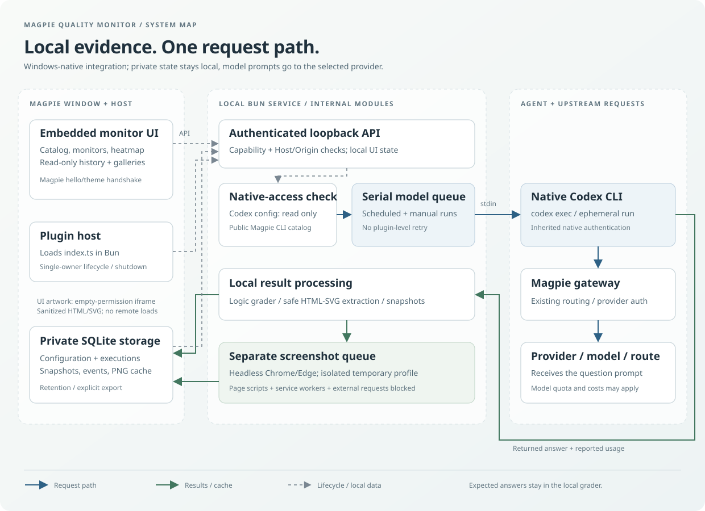

# Magpie Quality Monitor

[English](README.md) | [简体中文](README.zh-CN.md)

**固定题目，可核查回答，本地留存历史。**

一个嵌入 [Magpie](https://usemagpie.ai/) 的本地插件，通过 Windows 原生 Codex CLI
定时执行逻辑题与 HTML/SVG 绘图题，比较单次执行结果，并保留生成结果时的完整配置快照。
无需修改 Magpie 核心，也不接管供应商登录。

> 少量固定题目只能帮助观察，不能证明模型整体“降智”、供应商换模或服务掺假。
> 绘图用于人工比较，不提供自动美观评分或“绘图通过率”。

## 功能概览

- **逻辑题**：本地标准／等价答案、明确的最终答案提取，分别统计调用成功率与答案正确率。
- **绘图历史**：安全的 HTML/CSS/内联 SVG 预览、静态缩略图、每题独立画廊、耗时与 Token。
- **定时和手动执行**：多个监测对象共用串行队列，支持暂停、完整一轮和停用题目的单次运行。
- **执行热力图**：方格数量随宽度自适应，左旧右新、最新靠右；左侧灰格只是容量补位，不是失败。
- **可追溯历史**：不可变配置快照、跨配置统计、仅当前配置筛选与只读单次详情。
- **宿主集成**：沿用 Magpie 导航与主题，支持五种界面语言；首次打开自动检查接入并展示刷新进度。

## 环境要求

| 组件 | 要求 |
| --- | --- |
| 宿主 | 支持本地文件夹插件的 Windows 原生 Magpie |
| Agent | 已在 Magpie「Agent」页面接入的 Windows 原生 Codex CLI |
| 运行时 | Magpie 插件宿主提供的 Bun；不是普通 Node.js 后端 |
| 依赖安装 | GitHub 安装由 Magpie 管理依赖；手动源码安装与开发需要 Node.js/npm |
| 缩略图 | 本机 Chrome／Edge，或手动指定浏览器可执行文件 |

此前有限 CLI 兼容适配验证过 Magpie **0.1.1549** 与 Codex CLI **0.162.0**，不代表所有版本或接入模式均兼容。
不承诺支持 Linux、macOS、WSL Codex 或任意 Codex 配置覆盖，具体边界见 [验证说明](VERIFICATION.md)。

## 快速开始

### 1. 通过 GitHub 安装

在 Magpie「插件 → 添加插件」中输入：

```text
github:gitfot/magpie-quality-monitor
```

Magpie 会下载仓库并通过 Bun 安装运行依赖，无需手动克隆仓库或执行 npm。
安装后启用插件。后续通过 Magpie 的「更新」获取已发布提交，再重新打开插件页面。
本地开发修改只有推送到仓库后，才能被 GitHub 安装获取。

**同一个插件只保留一个安装项启用。** 本地文件夹副本与 GitHub 副本共享私有历史目录，
服务采用单一所有者机制。切换安装方式时，先停用旧副本，再启用新副本，不要删除私有历史目录。
两个副本可以同时保留安装，但不是两套独立监测服务，也不使用独立数据。

### 2. 接入 Codex 并打开监测页面

1. 在 Magpie「Agent」页面接入原生「Codex」。WSL 接入和旧的监测器专用 Agent 不能替代它。
2. 打开「Codex降智检测」。已有历史先展示，接入与模型目录自动后台刷新；等待期间按钮显示旋转图标并禁用重复点击。
3. 新建监测对象，从 Codex 可见目录选择模型或路由。新对象默认**暂停**；先检查每日请求估算，再启用定时，或手动单次运行。

发现失败时，可在插件设置中填写 Magpie／Codex 可执行文件的绝对路径，不要填写完整命令行。
目录刷新失败会显示原因并允许手动重试，不会删除历史。

### 替代方式：本地源码文件夹安装

在 [GitHub](https://github.com/gitfot/magpie-quality-monitor) 选择
**Code → Download ZIP**，解压到开发工作副本以外、可写的稳定文件夹。例如：

```powershell
Set-Location 'C:\Tools\magpie-quality-monitor'
npm.cmd ci --omit=dev --ignore-scripts
```

源码 ZIP 含 `package-lock.json`。本安装方式不依赖已发布的 npm 包或预编译 Release。

**不要把开发 Git 工作副本直接注册为长期安装目录。** 插件运行时会生成 `page/index.html`，
其中包含本地端点和临时访问令牌。它属于私有运行材料，不能提交或公开；单独安装副本可避免误暂存。
在 Magpie「插件 → 添加插件」中填写安装文件夹的绝对路径，然后按第 2 步接入并打开页面；先停用同插件的其他安装项。

## 架构



模型请求始终沿以下链路执行：

```text
Magpie 插件宿主 → 本地 Bun 服务 → 串行队列 → Codex CLI
                  → Magpie 网关 → 指定供应商模型或路由
```

接入适配只读必要的原生 Codex 配置及公共 `magpie models codex` 输出，不修改用户 Codex 配置。
标准答案只进入本地判分，不发送给模型。绘图提取与有界截图队列独立于模型队列。
SQLite 保存配置、不可变执行快照、事件与派生缩略图缓存。页面通过私有能力令牌访问回环 API。

入口先把启用的安装标识解析为实际目录，再判断是否启动服务。Git 来源通过宿主的
`plugins/package.json` 依赖映射定位，不把 `github:` 标识当成本地文件夹。
停用、移除或修改选项会使对应副本的活动检查失效，不会借用另一个启用副本的状态。

## 行为与统计口径

| 设置 | 默认值 |
| --- | --- |
| 定时周期 | 每 30 分钟一轮；新对象暂停 |
| 单请求超时 | 300 秒 |
| 历史保留 | 5 天，可设为 1–365 天 |
| 逻辑题／绘图输出请求 | 8,192／16,384 token；提示要求，不是 CLI 硬上限 |
| 首页时间范围 | 最近 24 小时，可切换保留期内的 7 天 |

- 逻辑题要求唯一 `FINAL_ANSWER:` 行。默认统一 Unicode 全半角、忽略空白和末尾句号，再与本地等价答案比较。
  可选全文兼容模式较宽松，可能把推理中的答案误判为正确。
- **调用成功率**以实际执行为分母；**答案正确率**以已判为正确／错误的回答为分母。
  超时、缺失最终答案标记、截断及调用错误分别记录，不冒充答错。
- 每个真实方格对应一次执行，可打开只读详情。窗口大小只影响可见数量，统计仍覆盖完整筛选范围。
  停机不在执行之间插入方格，也不补跑全部错过轮次。
- 修改配置只影响后续执行，不改写历史题目、答案或判定。在途请求沿用原快照；暂停停止后续题目。
  单题运行不会启用暂停对象。
- 插件不重试失败请求，但 Codex／供应商的重试及 Magpie 路由回退仍可能增加上游调用与费用。
- 画廊每页 20 张，仅包含可提取的完整作品；新失败不会替换旧成功作品。
  Token 为报告的输入加输出，不重复累加缓存／推理子项；未知值显示未知。

## 隐私、安全与费用

- 私有数据位于 `~/.magpie-quality-monitor/`，包含题目、完整回答、配置快照、SQLite 文件及所有权元数据。
  **不要公开该目录、运行时入口页或未经脱敏的历史导出。**
- 后端仅监听回环地址，并校验 Host、Origin 和授权；内嵌页面的 opaque origin 不是免鉴权条件。
- 作品经清理后在空权限 iframe 与严格 CSP 中预览。缩略图使用独立无头浏览器配置，禁用页面脚本、服务工作线程与外部请求，不自动下载浏览器。
- Codex 在空工作目录中以 ephemeral、只读沙盒和非交互审批运行，但**这不等于普遍禁用工具或网络**；继承的 Agent／MCP 配置仍可能影响行为。
- 题目会经 Codex 和 Magpie 发送给配置的供应商。接入恢复后，已启用对象可按原计划恢复监测，可能消耗付费额度。
- 隐私扫描只是发布前的一道防线，不等同完整安全审计；公开仓库或归档前仍需人工审查暂存内容。

## 开发

开发副本与 Magpie 中注册的安装副本应分离：

```powershell
git clone https://github.com/gitfot/magpie-quality-monitor.git
Set-Location magpie-quality-monitor
npm.cmd ci --ignore-scripts

# Bun 已在 PATH 中时不必设置；否则改为自己的可执行文件路径。
$env:MAGPIE_BUN = 'C:\Tools\bun\bun.exe'
npm.cmd run typecheck
npm.cmd run lint
npm.cmd test -- --timeout 60000
npm.cmd run check:privacy:selftest
npm.cmd run check:privacy
```

`npm.cmd run preview` 启动明确标注的本地模拟页面，不连接日常安装或付费供应商。
预览 URL 含临时能力令牌，不要分享或提交 `.test-artifacts`。

普通测试使用临时配置与本地模拟服务。UI 测试需要已安装的 Chrome，可用 `MAGPIE_BROWSER_CHANNEL=msedge`
选择 Edge；`npm.cmd run test:ui` 单独执行 UI 组。仓库中的 SVG 夹具为合成示例，不包含用户原始作品或真实账户目录。

可选原生集成需要同时设置 `MAGPIE_BINARY` 与 `MAGPIE_CODEX_BINARY` 的绝对路径，见 [验证说明](VERIFICATION.md)。
测试不能使用真实凭据或日常配置目录。

### 提交或公开前

```powershell
git add -- .
npm.cmd run check:privacy -- --staged
git diff --cached --check
git diff --cached
```

暂存模式扫描 Git index 中的实际文件内容，只输出位置和规则，不打印匹配值，并拒绝带运行能力令牌的入口页。
`.gitignore` 不能保护已跟踪文件。若真实密钥已经泄漏，仅修改最新文件不够，还需撤销／轮换并单独处理公开历史。
公开提交应使用明确允许公开的作者身份，例如 GitHub noreply 邮箱。

## 常见问题

| 现象 | 建议检查 |
| --- | --- |
| 接入或目录不可用 | 在 Magpie Agent 页接入原生 Codex，检查路径及具体提示，再手动刷新 |
| GitHub 副本一直显示正在启动 | 更新到包含 GitHub 安装识别修复的版本，再重新打开，并确认没有其他安装项同时启用 |
| 页面授权过期 | 从 Magpie 重新打开插件，不复用旧的本地 URL |
| 缩略图空白或缺失 | 安装 Chrome／Edge 或填写浏览器路径；查看原始隔离预览，或显式重试截图 |
| 长动画仍然偏淡 | 截图仅等待有界时间，不会等待任意长动画结束 |
| 编辑后历史统计不同 | 检查配置筛选与原执行快照；旧答案不会被重新判分 |
| 暂停时没有定时执行 | 启用定时或显式单题／整轮运行，不要绕过接入告警 |

可在 [GitHub Issues](https://github.com/gitfot/magpie-quality-monitor/issues) 报告最小可复现问题。
请先移除令牌、不可公开的题目与回答、个人路径和私有配置，附上版本和合成示例。

## 许可证与致谢

采用 [MIT](LICENSE)。插件从采用 MIT 的 Magpie 开发树独立拆出，保留上游版权声明，来源与合成夹具说明见
[NOTICE](NOTICE)。本项目为独立插件，不代表 Magpie 或 OpenAI 提供官方支持。
